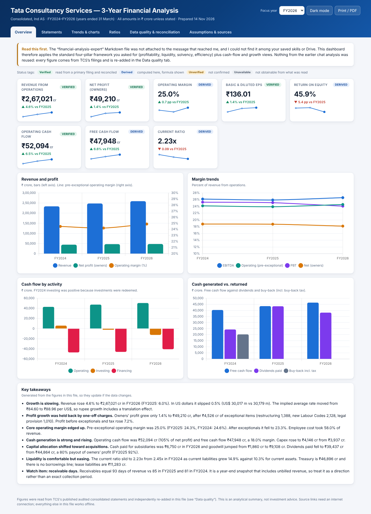

# TCS 3-Year Financial Analysis Dashboard (FY2024–FY2026)

An interactive, fully offline HTML dashboard analysing the consolidated financials of **Tata Consultancy Services (TCS)** for the years ended 31 March 2024, 2025 and 2026.

**[Live demo](https://prathamparmar-png.github.io/tcs-financial-dashboard/)** (after enabling GitHub Pages, see below) · or download `index.html` and open it in any browser.



## What it covers

| Tab | Contents |
|---|---|
| Overview | 8 KPI cards with a year selector, 4 charts, auto-generated takeaways |
| Statements | P&L, balance sheet, cash flow, with search and year-on-year change |
| Trends & charts | Selectable metric chart, cost structure, asset mix, funding, liquidity, returns, working capital |
| Ratios | 47 ratios across profitability, liquidity, solvency, efficiency, cash flow and growth. Click a row to see the formula with the actual numbers substituted |
| Data quality & reconciliation | 67 live arithmetic checks, cross-source checks and an issue log |
| Assumptions & sources | Definitions, limitations, links to the official TCS filings |

Light/dark mode, print-to-PDF, and a mobile-friendly layout are included.

## Data and verification

- All figures are from TCS's audited consolidated Ind AS statements (₹ crore), plus the IFRS US$ statement for US$ revenue and gross margin.
- FY2024 comes from the prior-year column of the FY2025 filing. FY2025 matches across both the FY2025 and FY2026 filings.
- Every subtotal, the balance sheet balance, the cash roll-forward and EPS are re-added inside the dashboard.
- Figures that could not be confirmed are **tagged, not estimated**: dividend per share is marked unverified, and borrowings, FY2024 growth rates and FY2024 US$ revenue are shown as unavailable.
- The Integrated Annual Report PDF was located but not parsed. A spot-check against it is recommended.

## Tech

Single self-contained HTML file: vanilla JavaScript and [Chart.js 4](https://www.chartjs.org/) inlined, so there are no external requests. Data and ratio formulas live in the same file.

## Run locally

```bash
git clone https://github.com/Prathamparmar-png/tcs-financial-dashboard.git
cd tcs-financial-dashboard
open index.html   # or double-click the file
```

## Sources

- [TCS consolidated Ind AS statements, FY2026](https://www.tcs.com/content/dam/tcs/investor-relations/financial-statements/2025-26/q4/IND%20AS/Consolidated.pdf)
- [TCS consolidated Ind AS statements, FY2025](https://www.tcs.com/content/dam/tcs/investor-relations/financial-statements/2024-25/q4/IND%20AS/Consolidated.pdf)
- [TCS consolidated IFRS (US$) statements, FY2026](https://www.tcs.com/content/dam/tcs/investor-relations/financial-statements/2025-26/q4/IFRS/Consolidated,%20Audited%20-%20USD.pdf)
- [TCS Integrated Annual Report 2026](https://www.ar.tcs.com/)

## Disclaimer

An analytical project built for learning and portfolio purposes. It is not investment advice.

## Author

**Pratham Parmar**, aspiring Data Analyst · [LinkedIn](https://www.linkedin.com/in/pratham-parmar-6635103a0/) · [GitHub](https://github.com/Prathamparmar-png)
